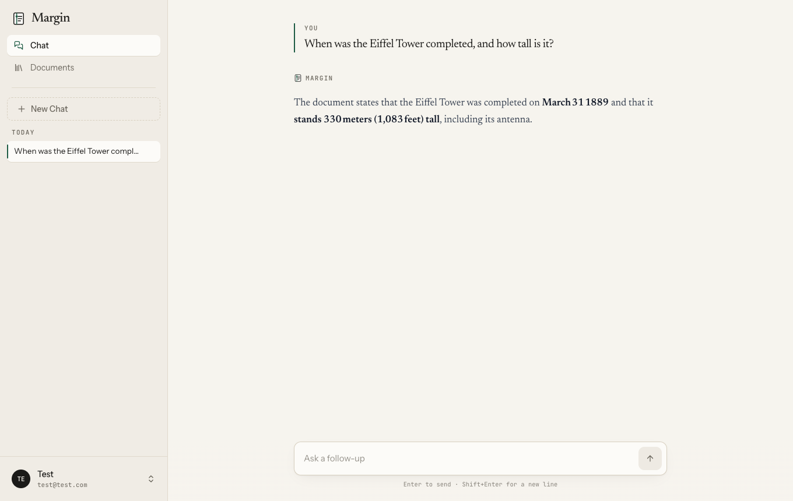
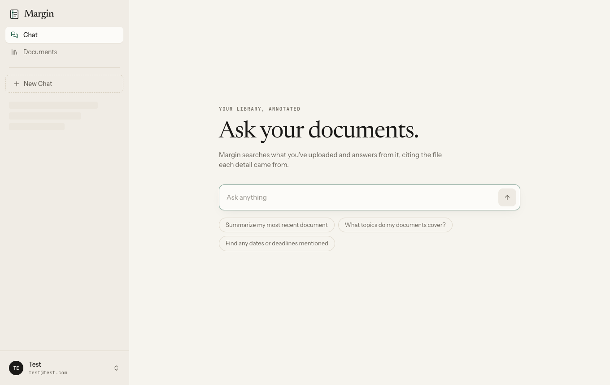
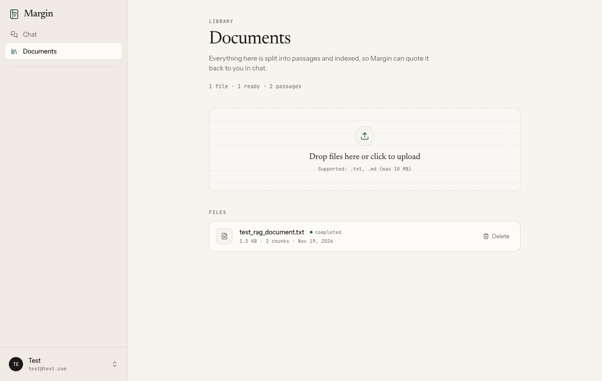
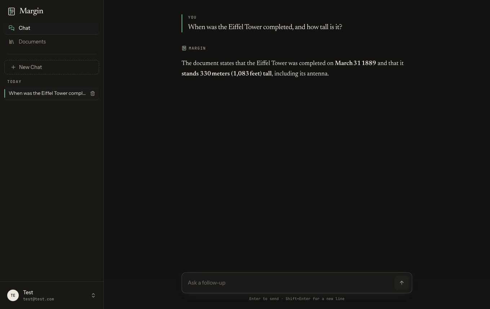
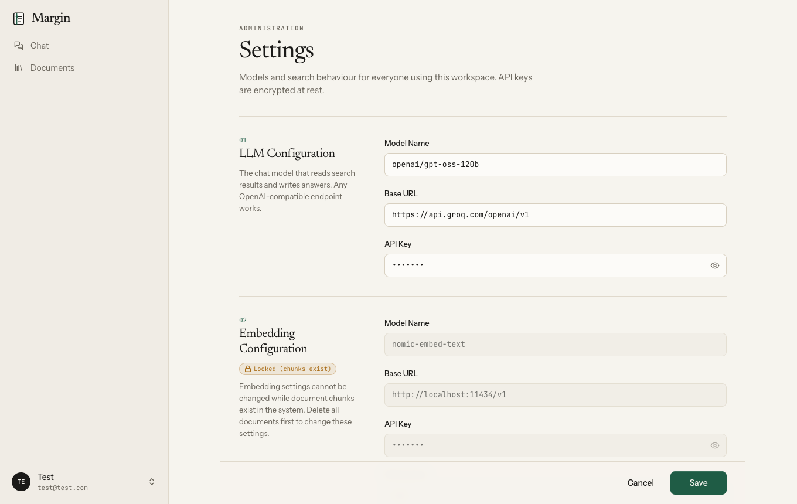
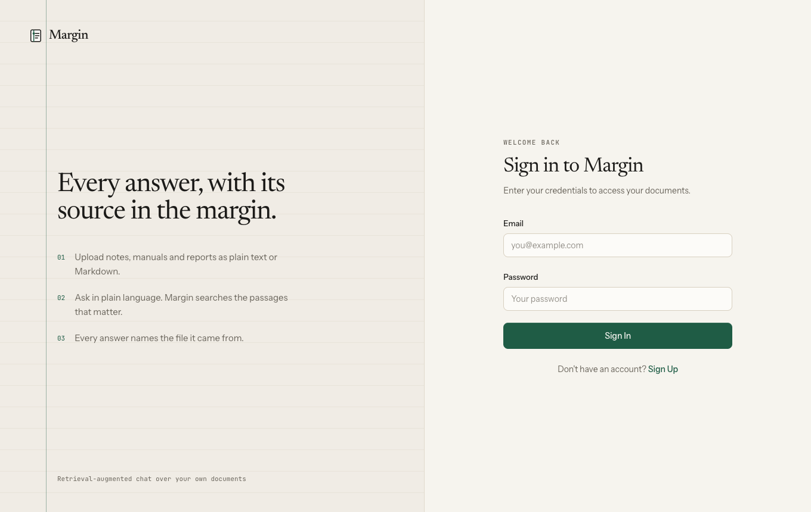
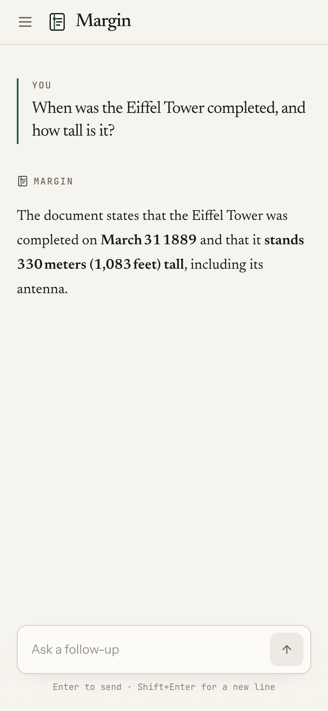
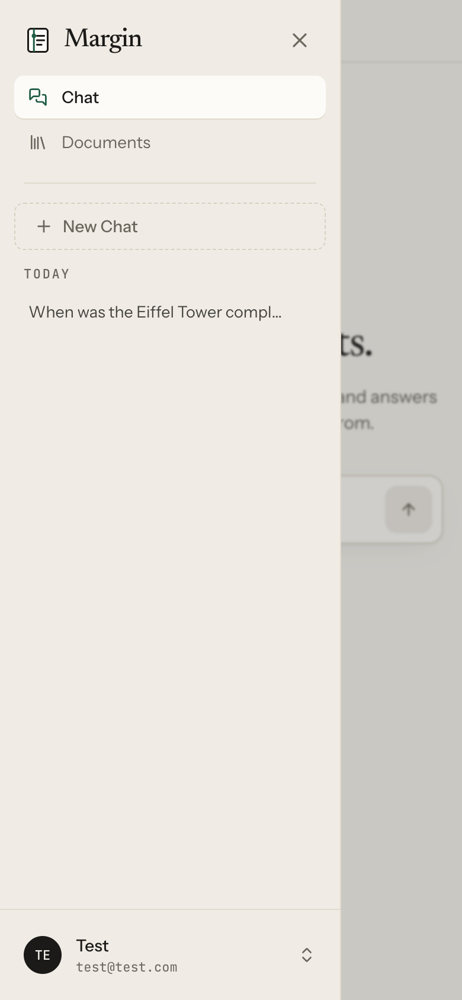
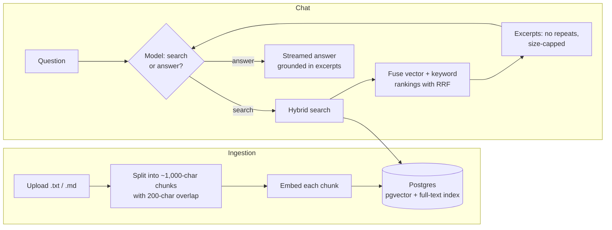

# Margin

Chat with your own documents. Upload text or Markdown files, ask questions in plain language, and get answers grounded in the passages that were retrieved, with the source file named.



## Features

- **Threaded chat** with streamed (SSE) answers rendered as Markdown
- **Agentic retrieval:** the model decides when to call a `search_documents` tool, over up to 3 search rounds per answer
- **Hybrid search:** pgvector cosine similarity + Postgres full-text keyword search, fused with Reciprocal Rank Fusion. Exact-keyword lookups return only the matching lines, to save tokens.
- **Document ingestion:** drag-and-drop `.txt` / `.md` (up to 10 MB), chunked, embedded and stored, with live status via Supabase Realtime
- **Multi-user:** Supabase Auth, row-level security on every table, admin role
- **Admin settings:** any OpenAI-compatible LLM and embedding endpoint, similarity threshold and max results; API keys encrypted at rest (Fernet)
- **Editorial UI** with light/dark themes and a mobile layout

## Screenshots

| Start screen | Documents |
|---|---|
|  |  |
| **Dark theme** | **Admin settings** |
|  |  |
| **Sign in** | **Mobile** |
|  |   |

## How it works



1. **Ingestion:** an uploaded file is stored in Supabase Storage, then processed in the background. It's split into overlapping chunks, each chunk is embedded, and the chunks are saved to Postgres with a vector column (pgvector) and a generated full-text search column. Supabase Realtime pushes status changes (`pending → processing → completed`) to the browser.
2. **Agentic search:** the chat model gets a `search_documents` tool and decides for itself whether to use it, for up to 3 search rounds per answer. It can pass a natural-language query plus a list of exact keywords, for example `["252", "387"]`.
3. **Hybrid retrieval:** one SQL function runs two searches over the user's chunks. Vector search ranks by cosine similarity (above an admin-set threshold). Keyword search uses Postgres full-text search, matching any of the terms. The two ranked lists are merged with **Reciprocal Rank Fusion** (`1/(60 + rank)` summed across both lists), so a chunk that ranks well in either list surfaces.
4. **Context budgeting:** results are trimmed before they reach the model. Exact-keyword hits come first and are cut down to just the matching lines. Chunks already shown earlier in the same answer aren't sent again, and each search result is size-capped. This keeps multi-search answers within small free-tier token limits.
5. **Grounded answers:** the system prompt and each tool result tell the model to state only what the excerpts say, to name the source file, and to label any general knowledge it used. Answers stream to the browser over Server-Sent Events.

## Stack

| Layer | Tech |
|---|---|
| Frontend | React, TypeScript, Vite, Tailwind |
| Backend | Python, FastAPI |
| Data | Supabase (Postgres + pgvector, Auth, Storage, Realtime) |
| LLM | Any OpenAI-compatible API (tested with Groq and Google Gemini) |
| Embeddings | Any OpenAI-compatible API or local Ollama (`nomic-embed-text`) |

## Project layout

```
backend/            FastAPI app (routers, services, Supabase client)
frontend/           React app
supabase/           SQL migrations + config (apply with `supabase db push`)
scripts/            start-all.sh / start-backend.sh / start-frontend.sh
docs/screenshots/   images used in this README
```

## Setup

1. **Supabase:** create a project, then link it and apply the migrations:
   ```bash
   supabase link --project-ref <your-ref>
   supabase db push
   ```
2. **Backend:**
   ```bash
   cd backend
   python3 -m venv venv
   venv/bin/pip install -r requirements.txt
   cp .env.example .env   # fill in the Supabase keys and SETTINGS_ENCRYPTION_KEY
   ```
   Generate an encryption key with:
   `venv/bin/python -c "from cryptography.fernet import Fernet; print(Fernet.generate_key().decode())"`
3. **Frontend:**
   ```bash
   cd frontend
   npm install
   cp .env.example .env   # VITE_SUPABASE_URL, VITE_SUPABASE_ANON_KEY, VITE_API_URL
   ```
4. **Embeddings (optional, local):** install [Ollama](https://ollama.com), then run `ollama pull nomic-embed-text`.

## Run

```bash
./scripts/start-all.sh      # backend on :8000, frontend on :5173 (Ctrl+C stops both)
```

Then open http://localhost:5173 and sign up. To make yourself an admin, run this in the Supabase SQL editor:

```sql
UPDATE user_profiles SET is_admin = true
WHERE user_id = (SELECT id FROM auth.users WHERE email = 'you@example.com');
```

As an admin, open **Settings** from the user menu and enter the LLM and embedding model, base URL and API key. Embedding settings lock once documents are indexed.
